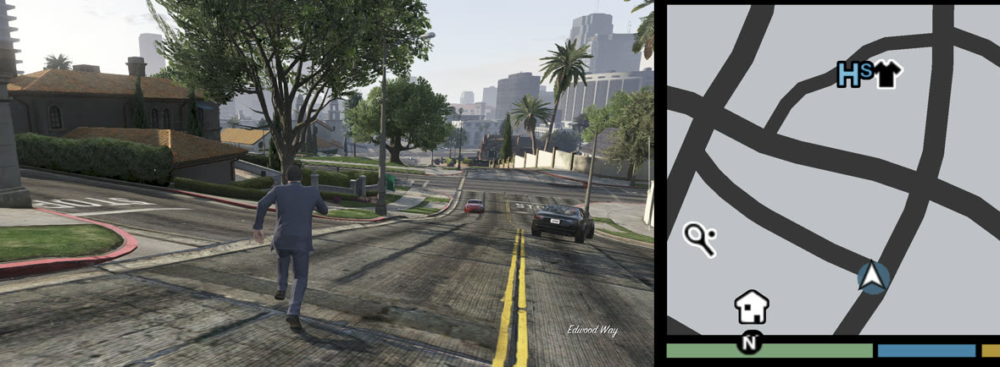
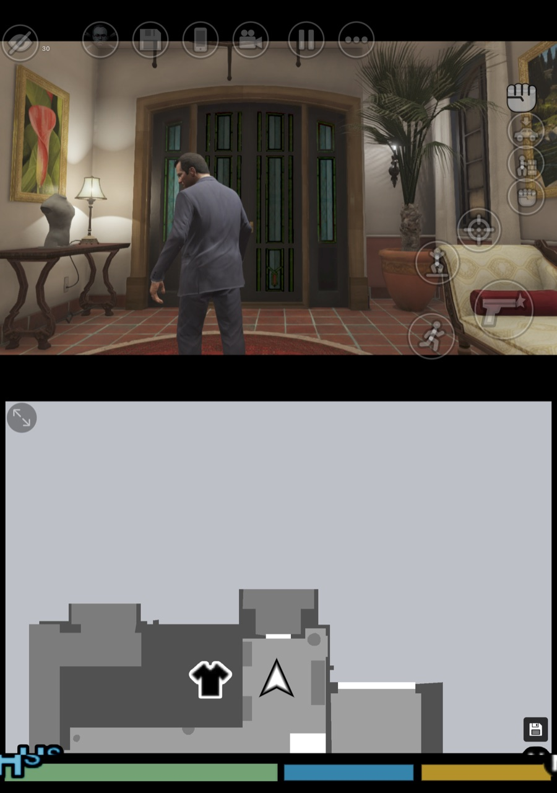
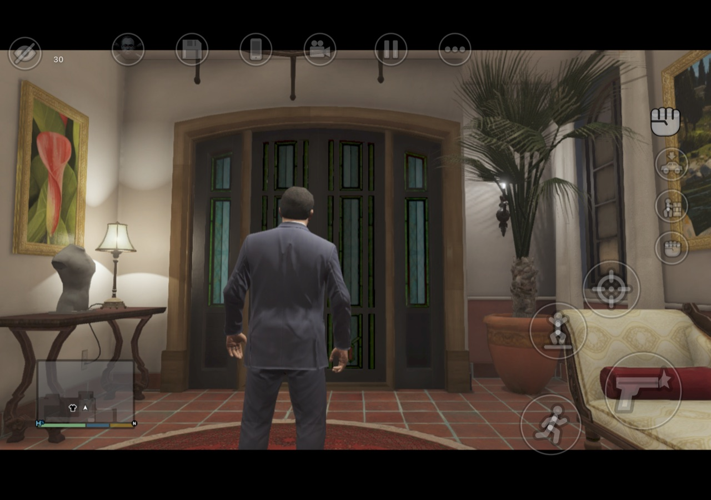
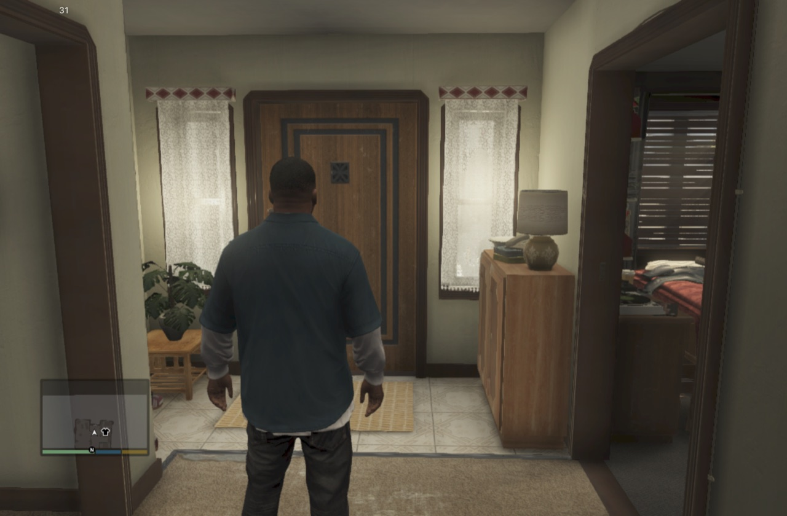
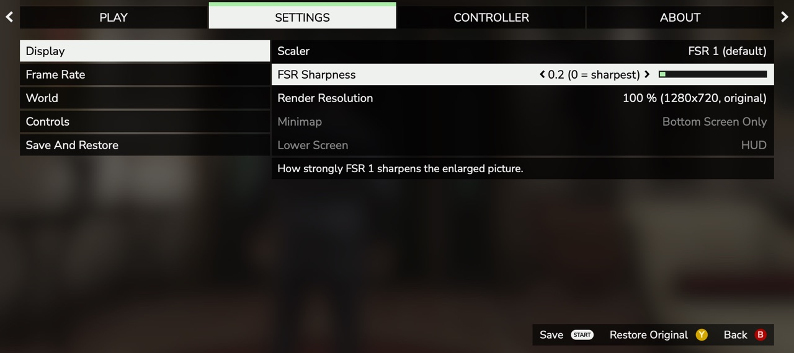

# FivePocket

FivePocket runs your own Xbox 360 copy of a 2013 open-world game on phones and tablets. It does this by static
recompilation: a builder on your own computer reads **your** discs and translates the game's PowerPC code and
shaders into a package for your device. The app itself contains no game code and no game data.

> **No game is included.** You need the two Xbox 360 discs of the game (Disc 1 "Install" and Disc 2 "Play") that you
> own. Nothing in this repository or in any FivePocket download comes from the game, and nothing you build from your
> discs may be shared. See [LEGAL.md](LEGAL.md).

FivePocket is an independent fan project. It is not affiliated with, endorsed by or sponsored by the game's
publisher or developer, by Microsoft, by Apple, by Google, by AYN, by Samsung, by Qualcomm or by AMD. All trademarks
belong to their owners; see [LEGAL.md](LEGAL.md#trademarks).

FivePocket is free. It is never sold, and no download asks for money.

## Screenshots

Captured on our test devices from discs we own (players may share captures of their own play; see
[LEGAL.md](LEGAL.md)).

**FivePocket Thor Edition:** the game on the main screen, the map on the lower screen.

| FivePocket Duo, portrait split | FivePocket Duo, landscape with touch controls |
|---|---|
|  |  |

| FivePocket iOS on an iPad mini (A17 Pro) | The launcher's settings |
|---|---|
|  |  |

## Editions

| Edition | Device | How you get the game onto it | Status |
|---|---|---|---|
| **FivePocket** | Android phones (arm64, Android 8.0+, Vulkan) | Windows builder, then import on the phone | public alpha |
| **FivePocket Thor Edition** | AYN Thor (dual screen: map, phone and touch controls on the lower screen) | Windows builder (Thor Edition), then import | public alpha |
| **FivePocket iOS** | iPad and iPhone ([supported devices](#supported-devices)) | builder on a Mac, then disc import on the device | public alpha |
| **FivePocket Duo** | the Duo (iPhone19,4), portrait split: the game on the top half, map, wheels and phone on the lower half | as iOS | public alpha |

"Thor" names the device the edition is made for (the AYN Thor); "iOS" names the platform. The names describe
compatibility only.

## Supported devices

| Edition | Tested on | Requirements and notes |
|---|---|---|
| FivePocket | Galaxy Z Fold4 (Snapdragon 8+ Gen 1) | Android 8.0 or later, arm64, Vulkan; Snapdragon 8-class or better |
| FivePocket Thor Edition | AYN Thor (Snapdragon 8 Gen 2) | the Thor's two screens |
| FivePocket iOS | iPad mini (A17 Pro, 8 GB): steady 30 fps at full resolution, the app uses 1.9-2.3 GB | iOS / iPadOS 17.4 or later |
| FivePocket Duo | the Duo (iPhone19,4), iOS 27.2, inner display, portrait or landscape | built for the iOS 27.1 SDK: an app built with an older SDK runs in a small compatibility window on the Duo |

Other devices are untested. The game needs about 2-2.5 GB of memory, so devices with 8 GB are the safe choice; on
6 GB devices iOS may close the app (an estimate, not a test).

## Performance (honest numbers)

FivePocket runs the game's own 30 frames-per-second design. These are development measurements, not promises:

| Device | Game frames | Notes |
|---|---|---|
| AYN Thor (Snapdragon 8 Gen 2) | steady 30 fps in our tests | with frame generation on, the screen shows about 60 (made frames between real ones) |
| Galaxy Z Fold4 (Snapdragon 8+ Gen 1) | around 25 fps | slows down when hot: the phone lowers its clock |
| iPad mini (A17 Pro) | steady 30 fps at full resolution | |
| Duo (portrait split) | steady 30 fps on foot | occasional hitches while driving |

The first launch builds shader caches and stutters briefly. Phones throttle when hot: a 3-minute reading is better
than a 30-second one, and expect lower numbers after 10 minutes of driving than in the first minute. Loading the
first scene takes longer than on the console.

## What you need

- Your own discs, ripped to ISO images (Disc 1 and Disc 2). FivePocket does not rip discs and does not tell you how
  to get images you do not own.
- For the Android editions (FivePocket, Thor Edition): a Windows PC for the builder (64-bit Windows 10/11 on x86-64,
  16 GB of memory recommended), 20 GB of free space for the build, plus about 3 GB for the Android NDK the builder
  downloads from Google (you accept Google's terms when it asks). Time, once per version: 2 to 4 hours.
- On an Android phone: about 19 GB free for the game files and 0.5 GB for the built package.
- For iOS and the Duo:
  - a Mac with Apple silicon and Xcode (tested with Xcode 26.5), 16 GiB of free space plus about 4 GB for the NDK;
    about an hour for the first app;
  - your own Apple ID to sign the app. A free Apple ID allows at most 3 sideloaded apps on a device, 10 new app IDs
    per 7 days, and the app must be re-signed within 7 days or it will not open;
  - on the device about 18 GB free for the imported files and the app; about 36 GB at once if you copy the disc images
    onto the device first. Disc images on a USB drive (picked with **Choose A Disc Image**) need no device space.

## Install

Downloads are on the [Releases page](https://github.com/marcm0de/FivePocket/releases). Every download has a
`README.txt` with the same steps for that download only.

### Android (FivePocket, FivePocket Thor Edition)

1. Download the app and its Windows builder: `FivePocket-<version>-android.zip` with
   `FivePocket-Builder-<version>-windows-x64.zip`, or `FivePocket-Thor-Edition-<version>-android.zip` with
   `FivePocket-Thor-Edition-Builder-<version>-windows-x64.zip`. Check them against `SHA256SUMS`.
2. Unpack the builder and, in a Command Prompt inside the download's builder folder (`cd builder`), run
   `builder fetch --accept-ndk-license --accept-dxc-license` (the Android NDK from Google and Microsoft's shader
   compiler from Microsoft), then `builder check`.
3. Run `builder build --play-disc <Disc2.iso> --install-disc <Disc1.iso> --out <folder>`. It writes one
   `.bundle` file. `builder verify <bundle>` checks it.
4. Install the APK on the phone and copy the bundle and your game files to it as the app's first-run screen says.
   The app imports them into its own storage; you can delete the copies afterwards.

Updating from a FivePocket alpha signed with an older key needs an uninstall first, and **an uninstall deletes your
saves**. Copy them out first (the app's Saves page shows where they are).

### iOS and Duo (iPad, iPhone)

There is no ready-made iOS app to download: the Mac builder makes the app on your Mac from your discs, and the game
files are imported on the device. The app it makes contains no disc files.

1. Download the Mac builder (`FivePocket-iOS-Builder-<version>-macos-arm64.zip`), check it against `SHA256SUMS`
   and unpack it. In Terminal, in the builder folder: `./builder fetch --accept-ndk-license`, then
   `./builder build --ios` (or `--duo`) `--play-disc PLAY-DISC.iso --install-disc INSTALL-DISC.iso`. It writes an
   unsigned `.ipa` from your Disc 1 and Disc 2 images and prints your app's bundle identifier.
2. Sign and install it with your own Apple ID (Xcode's free personal team works; Sideloadly or AltStore also work).
   **Always re-sign with the same bundle identifier**: a different one is a new app with empty storage, and the import
   must be done again. Never delete the app before reinstalling: deleting it removes the imported files and your saves.
3. On the device, turn on Developer Mode (Settings → Privacy & Security → Developer Mode → On, then restart). At the
   first launch iOS says "Untrusted Developer": Settings → General → VPN & Device Management → your Apple ID → Trust.
4. Make room: about 18 GB free, or about 36 GB if you copy the disc images onto the device. Offloading apps you don't
   need (Settings → General → iPad/iPhone Storage → an app → Offload App) keeps their data.
5. Put your two disc images (any file names: the app recognises each disc by its contents) into the app's folder: the
   Files app (On My iPad/iPhone → **FivePocket iOS**; for the Duo app, On My iPhone → **FivePocket Duo**) or Finder
   with the device connected. Or keep them on a USB drive and pick them with **Choose A Disc Image**.
6. Open the app. The **Import Game Discs** page checks every file against the known-good hashes and copies the game
   files into the app's own storage: about 2 minutes with the images in the app's folder (iPad mini, A17 Pro), longer
   from a USB drive. If you leave the app during the import, it stops cleanly and keeps every file already copied; it
   does not continue by itself. Start it again (**Import From The Files Folder** or **Choose A Disc Image**) and it
   copies only what is missing.
7. **After the import says both discs are done, delete the two disc images** from the app's folder in Files to get
   the space back. The game no longer needs them; keep your own copies on your computer.

A game controller works on iOS; without one, touch controls appear on screen.

### The Duo edition

The Duo edition is the iOS edition laid out for the Duo's inner display. A gamepad is the main way to play; touch
covers the lower screen and the menus, and the on-screen touch controls hide while a gamepad is connected.

- **Portrait, split (the default):** the top half shows the game's picture; the bottom half is the lower screen with
  the minimap or map, the weapon, radio and character wheels, the phone and help text. The divider stays at the middle.
- **Landscape, or Lower Screen Off:** full screen with the regular layout and no lower screen.
- **Top Screen** (side menu → Dual Screens → Lower Screen → Top Screen):
  - **Fit** (default): the whole picture, its shape kept, with thin bars where the screen's shape differs;
  - **Zoom**: enlarged to fill the top screen, its shape kept, with the edges cut off;
  - **Stretch**: the whole picture stretched to fill, no bars, nothing cut off;
  - **4:3**: the game's own non-widescreen layout (menus, loading screens and HUD placed for 4:3, a narrower view),
    drawn like Fit with thin bars at the sides. It needs a restart: the game reads its display mode once at start.
  Fit, Zoom and Stretch apply at once; the choice is kept across launches.
- In this build and covered by tests, not yet checked by touch on the device: picking a wheel on the lower screen
  (hold LB, D-pad Left or D-pad Down), tapping the map for a waypoint, answering (left half) or declining (right half)
  a call, Quick Save, the left-edge side menu, and the small full-screen button or a two-finger double tap.
- Saves stay in the app's own storage and survive reinstalls of the same app.

## Build from source

[docs/BUILDING.md](docs/BUILDING.md) lists the toolchains, the pinned upstream tools and the patch sets, and how to
make the app, the builder and the release checks yourself.

## Status

- Playable on the AYN Thor and on Snapdragon 8-class Android phones: the story's opening, free roam, driving and
  saving work; the rest of the story is still being played through and bugs are expected.
- Known issues and logs: [docs/TROUBLESHOOTING.md](docs/TROUBLESHOOTING.md); bugs go to the
  [issues](https://github.com/marcm0de/FivePocket/issues).
- iOS and the Duo: the Mac builder makes the app from your discs; it is tested on an iPad mini (A17 Pro) and on the
  phone the Duo layout was made for. Free Apple IDs must re-sign the app every 7 days; your imported files and saves stay.
- There is no Linux builder yet.

## Known issues

- **Fold-class phones slow down when hot.** On a Galaxy Z Fold4 (Snapdragon 8+ Gen 1) expect around 25 fps once the
  phone is warm: it lowers its clock to cool down. Playing without a case and not charging at the same time helps.
- **The Duo hitches while driving.** On foot it holds a steady 30 fps; driving shows occasional hitches.
- **The first launch stutters briefly** while the shader caches are built; it settles once they are.
- **iOS with a free Apple ID:** re-sign the app within 7 days or it will not open, and always re-sign with the **same
  bundle identifier** (a different one is a new app with empty storage). One free Apple ID can sideload at most 3 apps
  on a device and create 10 new app IDs per 7 days. Developer Mode must be on (Settings → Privacy & Security →
  Developer Mode), and the first launch needs Settings → General → VPN & Device Management → your Apple ID → Trust.
- **Android editions build on Windows only in this release;** a Mac builder for them is planned.
- **The iOS builder is tested with Xcode 26.5.** It checks every compiled unit against its record, so another Xcode
  version may stop with "REFUSED".
- **Closed-alpha Android users** must uninstall the old app first (it was signed with a different key), and
  **uninstalling deletes its saves**. Copy your saves out before you uninstall.

More help: [docs/FAQ.md](docs/FAQ.md) and [docs/TROUBLESHOOTING.md](docs/TROUBLESHOOTING.md).

## Never share what you build

| Never share, upload or sell | Why |
|---|---|
| disc images (`.iso`), files copied from your discs | they are the game |
| the `.bundle` the builder makes | it contains code translated from the game |
| the `.ipa` or `.app` the builder makes for iPad and iPhone | the same, inside the app |
| the builder's work folder | it holds the decoded game executable, translated code and shaders |
| the app's game-files folder, shader or pipeline caches | they come from the game's data and shaders |
| save files | they come from the game |
| screenshots and videos are fine | they are your own captures of your own play |

If you find game content anywhere in this repository or a download, please report it as described in
[LEGAL.md](LEGAL.md#reporting-content). Do not attach the content.

## Licence

FivePocket's own code is free software under the GNU General Public License, version 3 or (at your option) any later
version ([COPYING](COPYING)). Parts written by others keep their own licences; see
[THIRD-PARTY-NOTICES.md](THIRD-PARTY-NOTICES.md) and [LICENSES/](LICENSES/). The history of the code, and the
projects it grew from, are in [CREDITS.md](CREDITS.md).

## Contributing and community

See [CONTRIBUTING.md](CONTRIBUTING.md). Security problems and takedown requests: [SECURITY.md](SECURITY.md).
Chat with other players and get help on the [FivePocket Discord](https://discord.gg/mZvqCsxgxT) (never post game files there either).
